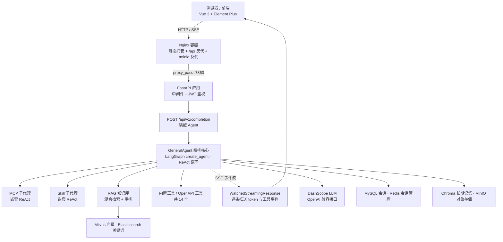
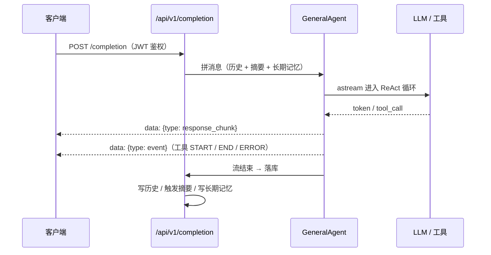

# AgentChat · 基于 LLM 的智能体应用平台

<div align="center">

<p align="center">
  
  
  
  
  
  
</p>

<p align="center">
  <b>多 Agent 编排 · RAG 知识库 · MCP 工具生态 · 长期记忆 · SSE 流式对话</b>
</p>

</div>

---

## 目录

- [一、项目定位与我的角色](#一项目定位与我的角色)
- [二、系统架构](#二系统架构)
- [三、核心链路拆解](#三核心链路拆解)
- [四、技术栈](#四技术栈)
- [五、我的工作](#五我的工作)
- [六、质量保障与测试](#六质量保障与测试)
- [七、技术难点与解决](#七技术难点与解决)
- [八、快速开始](#八快速开始)
- [九、目录结构](#九目录结构)
- [十、已知问题](#十已知问题)
- [十一、来源与许可](#十一来源与许可)

---

## 一、项目定位与我的角色

AgentChat 是一个 **LLM 驱动的智能体应用平台**：用户可自定义 Agent，为其挂载知识库、MCP 工具与 Skill；Agent 通过 ReAct 循环自主决策、多轮调用工具完成复杂任务，全程以 SSE 流式返回。

### 关于我的角色（如实说明）

**本项目的核心 Agent 框架来自开源项目**（见 [十一、来源与许可](#十一来源与许可)），并非我个人从零原创。我在其之上完成了**工程化落地、工具开发与质量体系建设**，这也是我投递大模型应用 / Agent 方向时主要想展示的部分：

| 维度 | 内容 |
|---|---|
| **我新增的文件** | 35 个功能文件（已通过比对上游仓库文件树逐文件核实）+ 4 个质量门禁文件 |
| **我负责的模块** | MCP Server 开发、RAG 链路端到端测试、生产级容器化部署、后端链路文档化、稳健型三件套（语义缓存 / Langfuse 埋点 / 评测 Harness）、接口级质量门禁 |
| **未改动的部分** | Agent 编排、RAG 检索、Memory 等核心逻辑保持上游实现 |

我选择如实标注来源，是因为把开源项目包装成个人原创在面试中经不起追问——**而"工程化落地"与"质量保障"恰恰是可以坦然深挖、也更容易讲出细节的部分**。

---

## 二、系统架构



**分层职责**

| 层 | 组件 | 说明 |
|---|---|---|
| 接入层 | Nginx | 唯一对外暴露的容器：静态托管 + API / 对象存储反向代理 |
| 应用层 | FastAPI + 中间件 | CORS、Trace、白名单中间件；lifespan 初始化配置、MySQL 种子、Redis SessionManager |
| 编排层 | LangGraph `create_agent` | ReAct 循环：LLM 决策 → 工具执行 → 结果回流 → 直到无 tool_calls |
| 能力层 | RAG / Memory / MCP / Tools | 统一以 `@tool` 挂载进 Agent；MCP 与 Skill 自身又是嵌套 ReAct |
| 存储层 | MySQL / Redis / MinIO / Milvus / ES / Chroma | 会话、缓存、文件、向量索引、关键词索引、长期记忆 |

---

## 三、核心链路拆解

### 1. 对话主链路（SSE 流式）



### 2. Agent 编排

`core/agents/general_agent.py` 通过 `create_agent(model, tools, middleware)` 装配：

- **8 种 Agent 实现**：`general_agent`、`react_agent`、`plan_execute_agent`、`mcp_agent`、`skill_agent`、`codeact_agent`、`structured_response_agent`、`text2sql_agent`
- **工具挂载**：MCP 子代理、Skill 子代理、RAG 知识库、OpenAPI 工具、内置工具（`tools/` 下 14 个）统一包装为 `@tool`
- **流式事件**：`EmitEventAgentMiddleware` 在循环中推送 START / END / ERROR

### 3. RAG 链路

```text
查询改写 (query_rewrite)
  → 混合检索 MixRetrival：Milvus 向量检索 ∥ Elasticsearch 关键词检索
  → 重排 Reranker (request_rerank / rerank_documents)
  → 阈值过滤 (min_score) → 组装上下文
```

`RagHandler` 同时负责**双写索引**（`index_milvus_documents` + `index_es_documents`）以及文档删除时的双端一致性清理（`delete_documents_es_milvus`）。

### 4. 长期记忆

`AsyncMemory` 不是简单的历史堆叠，而是**事实级记忆管理**：LLM 从对话中抽取事实，再决策执行 ADD / UPDATE / DELETE（`_create_memory` / `_update_memory` / `_delete_memory`），落入 Chroma / Milvus 向量库；检索时按 `user_id` / `agent_id` / `run_id` 维度过滤。

### 5. MCP 接入链路

```text
MCPConfig(type=sse, url) → convert_mcp_config → MCPManager
  → MultiServerMCPClient 连接（SSE / streamable_http / websocket）
  → 拉取远端 tools → 包装为 @tool → call_mcp_agent(query) 嵌套 ReAct
```

> **关键约束**：`convert_mcp_config` 只对 `sse` / `websocket` / `streamable_http` 生成配置，`type=stdio` 走 `else: pass` 返回 `None`。**因此本地 stdio 的 MCP 脚本无法进入 Agent 调用链，必须跑成 SSE 才能被 Agent 调用。**

---

## 四、技术栈

| 层 | 技术 |
|---|---|
| 后端 | Python 3.12 · FastAPI 0.121 · LangChain 1.2 / LangGraph · Pydantic v2 · SQLModel |
| 前端 | Vue 3.4 · Element Plus · Pinia · Vite 5 · TypeScript |
| 模型 | DashScope（OpenAI 兼容接口）：对话 / 工具调用 / 推理 / VL / Embedding |
| 存储 | MySQL 8.0 · Redis 7.0 · MinIO · Milvus · Elasticsearch · ChromaDB |
| 协议 | SSE 流式 · MCP（Model Context Protocol）· JWT · Swagger / OpenAPI |
| 工程化 | Docker 多阶段构建 · Docker Compose · Nginx 反向代理 · Bash 自动化部署 |
| 质量 | unittest 离线单测 · AST 静态扫描 · 路由契约比对 · vue-tsc 类型门禁 · GitHub Actions |

---

## 五、我的工作

### 5.1 MCP Server 开发与调试

`src/backend/agentchat/mcp_servers/demo/`（新增）

基于 FastMCP 实现了演示工具型 MCP Server，用于走通「写代码 → 启动 → 注册 → Agent 调用」全流程：

- **双传输支持**：`--transport stdio`（配合 MCP Inspector 本地调试）与 `--transport sse`（供 AgentChat 后端以 URL 方式注册调用）
- **三个工具**：`echo`（连通性自测）、`get_current_time`（IANA 时区，含 UTC 回退）、`calculate`（四则运算）
- **安全求值**：`calculate` 不使用 `eval`，而是用 `ast` 模块做白名单解析（仅允许 `+ - * / ( )` 与数字常量，拒绝函数调用、属性访问、变量引用），**从根上杜绝任意代码执行**
- **文档即 Schema**：工具 docstring 会作为暴露给 LLM 的调用说明，因此按「用途 + 参数语义 + 边界」三段式书写

### 5.2 RAG 链路端到端测试

`scripts/test_rag_e2e.py`（新增）

针对"知识库问答"这条最容易出问题的链路，写了一个**可重复执行的端到端验证脚本**：

1. 在容器内直接签发 JWT（`docker exec` 调用应用自身的 `AuthJWT`），避免手工拷贝 token 过期
2. 创建 RAG Agent 会话 → 发送问题 → 按 **SSE 协议逐行解析** `data:` 帧
3. 区分并断言两类事件：`event`（工具调用）与 `response_chunk`（token 流）
4. 双重断言：**RAG 工具是否真被调用**（匹配"检索知识库"事件）+ **回答是否真的引用了知识库内容**（关键词命中）

> 价值在于把"RAG 好像能用"变成"链路的每一步都有断言"，回归时可一键验证。

配套新增 `test-rag-data/` 下 4 份知识库测试语料（产品功能列表、技术问答手册、项目说明、部署运维手册），覆盖问答类检索场景。

### 5.3 生产级容器化部署

`docker/` 下新增 10 个文件，把项目从"开发能跑"推进到"公网可部署"：

| 文件 | 作用 |
|---|---|
| `Dockerfile.prod` | 后端生产镜像，多阶段构建 |
| `Dockerfile.frontend.prod` | 前端多阶段构建 → Nginx 静态站点（替代 Vite dev server） |
| `docker-compose.prod.yml` | 生产编排：仅暴露 Nginx，其余服务全走内部网络 |
| `nginx/nginx.prod.conf` | 静态托管 + `/api` 与 `/minio` 反代 + SSE 专项配置 |
| `deploy.sh` | 693 行一键部署：环境预检 → 自动生成密钥 → 渲染配置 → 构建启动 → 验收自检，支持 `--verify` / `--down` |
| `.env.prod.example`、`docker_config.prod.template.yaml` | 配置模板，真实凭据排除出版本控制 |
| `docker-compose.local.yml`、`docker_config.example.yaml` | 本地编排与配置示例 |
| `start_tunnel.sh` / `.bat` | 内网穿透脚本（无公网 IP 时对外演示） |

**设计要点**

- **最小暴露面**：只有 Nginx 映射宿主机 80/443，MySQL / Redis / MinIO / backend 均不映射端口
- **口令强制注入**：所有口令用 `${VAR:?错误提示}` 注入，未配置则**启动即失败**，杜绝"忘记改弱口令就上线"
- **安全加固**：原代码 JWT 密钥硬编码为 `secret`（可被伪造 token），改为环境变量注入，未配置时退化为每次启动随机生成；CORS 由放行 `*` 收紧为显式白名单
- **可运维性**：全服务 `healthcheck` + `depends_on: condition: service_healthy` 编排启动顺序；日志 `max-size` / `max-file` 轮转防写满磁盘
- **数据持久化**：显式声明 `backend_memory_db` / `backend_vector_db` 卷——不挂载则容器重建会清空全部长期记忆与知识库索引
- **配置挂载而非打进镜像**：改一个 API Key 只需 `docker compose restart backend`，无需重建镜像（避免重跑 `uv sync` 与 Chrome 下载的十几分钟）

### 5.4 技术文档化

| 文档 | 内容 |
|---|---|
| `backend-chain-overview.html` | 后端链路学习手册：全景链路、GeneralAgent 编排结构、MCP 子代理接入链路、SSE 流式链路，含逐文件职责对照表 |
| `public-deploy-checklist.html` | 公网部署清单（学生预算版）：从选购服务器、加 swap、ICP 备案到 HTTPS 绑定的完整可执行流程 |

两份文档均为**自包含 HTML**，可离线打开、可直接打印为 PDF。

### 5.5 稳健型三件套：语义缓存 · Langfuse 埋点 · 评测 Harness

新增 11 个文件、改动 11 个文件，配套 **87 个离线单测**。

要解决的问题：改一次提示词或检索参数，效果是变好还是变坏？此前只能靠主观感受回答。三件套分别对应**降本**（语义缓存）、**可观测**（Langfuse 埋点）、**可回归**（评测 Harness），**默认全部关闭**，不改变现有行为。

#### 语义缓存

`src/backend/agentchat/services/semantic_cache.py`（新增）——基于 Redis + embedding 的答案缓存，三重判据全部满足才命中：

| 判据 | 作用 |
|---|---|
| 余弦相似度 ≥ `threshold` | 问题语义足够接近（float64 计算后夹取到 [-1, 1]，规避 float32 精度导致的假 1.0） |
| `kb_version` 一致 | 知识库内容变更即不允许复用旧答案 |
| `prompt_hash` 一致 | 提示词模板改动则全局失效 |

**接入门控**（`cache_eligible()`，纯函数、无 IO、可单测）——任一条不满足即走真实链路：

1. 带附件（答案依赖附件内容，不可跨请求复用）
2. 开启长期记忆（多轮个性化场景，缓存会让答案过期）
3. 非会话首轮（有短期历史，答案依赖上下文）

另处理三个工程细节：SCAN 与 HGETALL 之间的**竞态**（期间被淘汰则本轮放弃，而非返回空）、命中后**刷新 TTL**、写回时**跳过知识盲区兜底答案**（避免把"我不知道"缓存成标准答案）。

**为什么默认 `enabled: false`**：`threshold` 未在真实问答对上标定前，误命中等于把 A 问题的答案返回给 B 问题，且用户无从察觉。标定工具 `scripts/calibrate_threshold.py` 输出建议阈值与**分离度诊断**（同义问 P05 与不同义问 P95 的距离）。

#### Langfuse 可观测埋点

`src/backend/agentchat/services/langfuse_trace.py`（新增），在 `general_agent.py` 的 `AgentMiddleware.awrap_model_call` 与 `completion.py` 的 SSE 主链路各埋一级：

| 层级 | 记录内容 |
|---|---|
| 对话级 `trace_chat` | span 根：一次 `/api/v1/completion` 请求 |
| 模型调用级 `trace_generation` | 每次模型调用的输入输出、token 用量、耗时 |

**双重降级**：`langfuse` 包未安装 → 静默跳过；配置关闭或客户端初始化失败 → 静默跳过。观测写失败只记日志、不向上抛——**埋点不能拖垮主链路**。`trace_generation` 是真正的上下文管理器：异常路径标记 `level="ERROR"` 后重新抛出，不吞异常。

#### 评测 Harness 与黄金集

`scripts/eval_harness.py` + `scripts/golden_set.jsonl` + `scripts/baseline.json`（新增）

```bash
python scripts/eval_harness.py --self-test                        # 不联网：验证 harness 自身与门禁双向有效性（7 项）
python scripts/eval_harness.py --golden scripts/golden_set.jsonl --validate-only   # 只校验黄金集 schema
python scripts/eval_harness.py --endpoint http://localhost:7860 --token <JWT> --dialog-id <id>   # 真实回归
python scripts/eval_harness.py --endpoint ... --update-baseline   # 更新基线（只升不降，--force 可强制覆盖）
```

- **指标口径**：`pass_rate`、`per_type`（按用例类型拆分）、`balanced_accuracy` = 拒答类召回 + 引用类不误拒——专门防"全都引用"和"全都拒答"两种作弊式高分
- **门禁方向**：低于基线即非零退出；`baseline.json` 的 `pass_rate` 为 0 时**打印警告而非放行**，避免"假门禁"
- **CI 边界**：CI 只跑 mock 自测与 schema 校验；真实回归需要 MySQL + Redis + Chroma，属 **staging 手动流程**

#### 启用方式

| 场景 | 操作 |
|---|---|
| 本地开发 | `src/backend/agentchat/config.yaml` 中加入 `semantic_cache` / `langfuse` 块（该文件被 `.gitignore` 排除、不入库，键名与默认值可参照已入库的 `docker/docker_config.example.yaml`；缺键时代码安全降级为关闭） |
| 生产部署 | `docker/.env.prod` 填 `SEMANTIC_CACHE_ENABLED/THRESHOLD/TTL/KB_VERSION` 与 `LANGFUSE_PUBLIC_KEY/SECRET_KEY/HOST`；`deploy.sh` 会做配对校验（只填一半直接退出）与取值校验（threshold 须在 (0,1) 开区间、kb_version 不含 `:`） |

#### 诚实边界（未闭环的部分）

1. **`threshold: 0.90` 是占位默认值**，尚未在真实问答对上标定；启用前必须跑 `calibrate_threshold.py`
2. **黄金集 24 条全部是 `seed: true` 占位样本**（通用电商 FAQ），不是本知识库的真实问答，上线前应替换
3. **HTTPS（P0-2）本轮未闭环**——语义缓存与 Langfuse 公网实例的传输层保障都依赖它
4. **Langfuse 成本字段需人工补**：token 用量已上报，但 qwen 系列单价未内置，`cost_details` 需按当时单价手工补齐
5. **真实回归门禁未进 CI**：需完整中间件栈，目前只有 staging 手动流程

---

## 六、质量保障与测试

功能迭代速度远快于回归速度，是这个项目最初的真实状态：CI 只校验 YAML / Compose / Nginx 语法，**接口行为没有任何自动化保护**。为此我补了一层"不需要数据库也能跑"的接口级门禁（`qa/`，新增 5 个文件）。

### 6.1 三层门禁

| 层 | 脚本 | 检查内容 | 耗时 |
|---|---|---|---|
| 静态 | `qa/static_scan.py` | AST 级：裸 `except`、静默吞异常、可变默认参数、`eval`/`subprocess`/`pickle.loads`、SQL 拼接、硬编码密钥、关闭 TLS 校验 | < 1s |
| 契约 | `qa/contract_check.py` | 真实构建后端路由表（86 条）vs 前端 71 处 `/api/v1/*` 调用，双向比对 | ~ 5s |
| 行为 | `qa/test_api_authz.py` | 17 个鉴权/越权用例：真实路由 + 真实中间件 + 真实 JWT 依赖，仅对 DAO 打桩 | ~ 8s |

**关键设计：接口测试不需要 MySQL / Redis。** 被测对象是"授权判定逻辑"本身——路由、`WhitelistMiddleware`、`get_login_user` 依赖、JWT 解码、响应封装全部使用仓库真实代码，只有 `*Dao` 层被打桩返回固定数据。因此"匿名请求是否进入业务逻辑""用户 A 能否拿到用户 B 的数据"这类断言是可信的，且能在 CI 里秒级跑完。

### 6.2 实测结论

| 项 | 结果 |
|---|---|
| 既有离线单测 | 87 项全部通过 |
| JWT 加固 | 伪造签名 / 过期 / `alg=none` / refresh 冒充 access **均被拒绝**（401） |
| 新增鉴权用例 | 17 项全部通过 |
| 缺陷发现 | **2 个 P0、8 个 P1、5 个 P2、5 个 P3** |

三类最值得记录的问题（完整清单见 [`qa/TEST_REPORT.md`](qa/TEST_REPORT.md)）：

1. **鉴权是逐接口手工挂载的，没有全局兜底。** 86 个端点里 76 个声明了 `Depends(get_login_user)`，遗漏的 10 个中，`/user/info`、`/user/update` 两个可以被**匿名读写任意用户资料**（且 `UserTable.hide_fields` 为空，序列化结果带出密码哈希）。这类缺陷靠人工 review 极难穷举——用"枚举路由 + 断言 401"的测试反而一抓一个准。
2. **白名单前缀匹配会"串味"。** 配置 `/api/v1/mcp/*` 归一化后前缀是 `/api/v1/mcp`，`startswith` 会同时命中 `/api/v1/mcp_server` 与 `/api/v1/mcp_user_config`；而白名单路径在 `get_login_user` 里直接返回 `UserPayload(user_id="1")`——**跳过 JWT 校验并授予管理员身份**。生产模板的 `whitelist_paths: []` 不受影响，但仓库自带的本地/示例配置是踩着的。
3. **前后端契约靠人眼维持。** 比对出 5 处前端调用指向不存在的后端路由（含 `/user/logout` 缺失导致"登出后 token 仍有效"），以及 1 处字段名不一致（`mcp_server_id` vs `server_id`）使"MCP 用户配置保存"**功能 100% 失败**。这一处同时被 `vue-tsc` 报出（`TS2561`），说明类型门禁一旦进 CI，同类问题就再也漏不掉。

### 6.3 建议的 CI 追加项

```yaml
- name: 接口鉴权回归
  run: python3 qa/test_api_authz.py          # 17 用例，无需 MySQL/Redis

- name: 前后端契约
  run: python3 qa/contract_check.py           # 前端调用 404 即失败

- name: 前端类型门禁
  run: cd src/frontend && npm ci && npx vue-tsc --noEmit
```

三项合计约 20 秒，不需要任何外部服务。

---

## 七、技术难点与解决

以下均为我在部署与调试中实际遇到并解决的问题，按「现象 → 根因 → 方案」记录。

### 1. Nginx 缓冲导致 SSE 流式效果消失

- **现象**：本地开发"打字机"效果正常，走 Nginx 反代后响应被攒成一整块一次性返回
- **根因**：Nginx 默认缓冲上游响应
- **方案**：`/api/` 段关闭 `proxy_buffering` / `proxy_cache` / `proxy_request_buffering`，追加 `X-Accel-Buffering: no`，该段单独 `gzip off`（压缩同样引入缓冲），并把 `proxy_read_timeout` 从默认 60s 提到 3600s——LLM 生成叠加多轮工具调用的耗时远超 60s，否则长对话会中途断开

### 2. Nginx 启动即失败：upstream 主机名解析时机

- **现象**：`emerg: host not found in upstream "backend:7860"`，前端整体不可用
- **根因**：Nginx 在**配置加载时**解析 `upstream` 中的主机名，而容器启动顺序不确定，此时后端尚未注册 DNS
- **方案**：改用 `resolver 127.0.0.11 valid=10s` + 变量写法 `set $backend_upstream ...; proxy_pass $backend_upstream;`，把解析**推迟到每次请求**。后端短暂不可用只返回 502，而不会让 Nginx 起不来

### 3. MinIO 反向代理的两个叠加坑

- **现象**：`/minio/...` 返回 `AccessDenied`，响应 XML 中 `<Resource>/</Resource>`；或直接 500 并报 `using uninitialized variable` + `invalid URL prefix in ""`
- **根因**：两个独立机制叠加
  - 坑 1：`proxy_pass` 使用变量时若同时带 URI（如 `proxy_pass $var/;`），该 URI 会**整体替换**原始请求 URI，`/minio/agentchat/x.jpg` 被改写成 `/`
  - 坑 2：`set` 与 `rewrite` 同属 rewrite 阶段且按书写顺序执行，而 `rewrite` 的 `break` 会**终止后续 rewrite 阶段指令**——`set` 若写在 `rewrite` 之后则永不执行
- **方案**：固定为 `set` 在前 → `rewrite ... break` → `proxy_pass` 不带 URI

### 4. 生产编排复用了开发环境的数据卷

- **现象**：生产后端启动后连不上 MySQL
- **根因**：不指定项目名时，Compose 项目名取自**目录名**（两者都在 `docker/`，项目名同为 `docker`），卷名相同 → 生产编排复用了开发环境的数据库卷；而 MySQL 的 `MYSQL_ROOT_PASSWORD` **仅在数据目录为空时生效**，于是新口令去连旧库，认证必然失败
- **方案**：显式声明 `name: agentchat-prod` 隔离项目命名空间

### 5. 2 核 2G 服务器构建阶段 OOM

- **现象**：前端构建过程中进程被杀死
- **根因**：内存不足
- **方案**：部署前先添加并持久化 2G swap（写入 `/etc/fstab`），构建完成后可保留

### 6. 挂载路径不存在时 Docker 静默创建同名目录

- **现象**：配置文件挂载后应用读取失败，且报错信息难以定位
- **根因**：宿主机挂载源路径不存在时，Docker 会**创建一个同名空目录**并挂进去
- **方案**：`deploy.sh` 中强制先生成配置文件再启动容器，并在脚本注释中标注该约束

### 7. 本地 stdio MCP Server 无法被 Agent 调用

- **现象**：MCP Server 本地调试正常，注册后 Agent 却始终不调用
- **根因**：`convert_mcp_config` 只处理 `sse` / `websocket` / `streamable_http`，`stdio` 分支返回 `None`，根本不进执行链路
- **方案**：以 `--transport sse` 启动并注册 URL

### 8. `add_header` 在 location 内会重置继承

- **现象**：`server` 级声明的 `X-Content-Type-Options` / `X-Frame-Options` 在 `/minio/`、`/assets/` 等 location 下"消失"
- **根因**：nginx 的 `add_header` **不合并**——当前层级只要出现一条 `add_header`，上一层的同名指令全部不再继承
- **方案**：需要缓存头的 location 内显式重复声明安全头（本项由 `qa` 阶段的静态检查发现，属待验证/待修）

---

## 八、快速开始

### 1. 生产部署（推荐）

```bash
cd docker

# 首次部署：填写密钥（口令留空可由脚本自动生成）
cp .env.prod.example .env
vim .env

# 一键部署：环境预检 → 生成密钥 → 渲染配置 → 构建启动 → 验收自检
./deploy.sh

# 仅做验收自检，不重新部署
./deploy.sh --verify

# 停止并移除容器（保留数据卷）
./deploy.sh --down
```

部署完成后访问 `http://<服务器IP>`。绑定域名与 HTTPS 的完整步骤见 `public-deploy-checklist.html`。

### 2. 本地开发

**后端**

```bash
cd src/backend

pip install -r requirements.txt
# 或使用 uv（更推荐）
pip install uv && uv sync
```

**前端**

```bash
cd src/frontend
npm install
npm run dev
```

### 3. 运行质量门禁（无需数据库）

```bash
# Windows
PY=src/backend/.venv/Scripts/python.exe
# Linux / macOS
PY=src/backend/.venv/bin/python

$PY qa/static_scan.py            # 静态缺陷扫描
$PY qa/contract_check.py         # 前后端契约比对
$PY qa/test_api_authz.py -v      # 接口鉴权测试（17 用例）
```

### 4. 运行 RAG 端到端测试

```bash
# 需后端容器已启动（容器名 agentchat-backend）
python scripts/test_rag_e2e.py
```

### 5. 调试自建 MCP Server

```bash
cd src/backend/agentchat/mcp_servers/demo

# 本地 stdio 调试（配合 MCP Inspector）
python mcp_demo.py --transport stdio

# 以 SSE 启动，供 AgentChat 注册调用
python mcp_demo.py --transport sse --host 0.0.0.0 --port 8001
```

### 6. 运行评测 Harness（语义缓存 / 埋点的回归验证）

```bash
# 不联网自测：验证 Harness 自身逻辑与门禁双向有效性（约 4 秒）
python scripts/eval_harness.py --self-test

# 语义缓存与埋点的离线单测（不依赖数据库）
python scripts/test_semantic_cache.py
python scripts/test_langfuse_trace.py

# 真实回归：需后端已在运行，并准备好 JWT 与 dialog_id
python scripts/eval_harness.py --endpoint http://localhost:7860 \
    --token <JWT> --dialog-id <dialog_id>
```

### 环境要求

- Python 3.12+ · Node.js 18+
- Docker Engine 20.10+ 与 Docker Compose V2
- MySQL 8.0+ · Redis 7.0+
- 2 核 2G 服务器需先加 2G swap（见 `public-deploy-checklist.html`）

---

## 九、目录结构

```text
AgentChat/
├── docker/                          # 容器化与部署（新增 10 个文件）
│   ├── Dockerfile.prod              #   后端生产镜像
│   ├── Dockerfile.frontend.prod     #   前端多阶段构建 → Nginx
│   ├── docker-compose.prod.yml      #   生产编排
│   ├── nginx/nginx.prod.conf        #   反代 + SSE 专项配置
│   ├── deploy.sh                    #   一键部署与验收自检
│   └── start_tunnel.sh / .bat       #   内网穿透
├── qa/                              # 接口级质量门禁（新增）
│   ├── static_scan.py               #   AST 静态缺陷扫描
│   ├── contract_check.py            #   前后端路由契约比对
│   ├── test_api_authz.py            #   鉴权 / 越权测试（17 用例）
│   ├── README.md                    #   脚本用法与设计说明
│   └── TEST_REPORT.md               #   质量评估报告（缺陷清单）
├── scripts/
│   ├── test_rag_e2e.py              # RAG 链路端到端测试（新增）
│   ├── upload_to_kb.py              # 知识库批量上传工具（新增）
│   ├── dashscope_proxy.py           # 模型接口代理（新增）
│   ├── eval_harness.py              # 评测 Harness：黄金集回归 + 门禁（新增）
│   ├── golden_set.jsonl             # 黄金集 24 条，全部标记 seed 占位（新增）
│   ├── baseline.json                # 指标基线，只升不降（新增）
│   ├── calibrate_threshold.py       # 语义缓存阈值标定工具（新增）
│   └── test_semantic_cache*.py      # 三件套离线单测（共 6 个文件 / 87 用例，新增）
├── test-rag-data/                   # RAG 测试语料（新增）
├── backend-chain-overview.html      # 后端链路学习手册（新增）
├── public-deploy-checklist.html     # 公网部署清单（新增）
└── src/
    ├── backend/agentchat/
    │   ├── main.py                  # 应用入口 / 中间件 / lifespan
    │   ├── api/v1/                  # completion(SSE) / dialog / knowledge / mcp_server ...
    │   ├── core/agents/             # 8 种 Agent 实现（general_agent 为编排核心）
    │   ├── core/models/manager.py   # 多模型管理（对话 / 工具调用 / 推理 / VL / embedding）
    │   ├── services/rag/            # 混合检索 + 重排 + 双写索引
    │   ├── services/memory/         # 事实级长期记忆（ADD / UPDATE / DELETE）
    │   ├── services/semantic_cache.py   # 语义缓存（默认关闭，新增）
    │   ├── services/langfuse_trace.py   # Langfuse 埋点（默认关闭，新增）
    │   ├── mcp_proxy/               # MCP 客户端、JSON-RPC、Schema 转换
    │   ├── mcp_servers/demo/        # 自建 MCP Server（新增）
    │   └── tools/                   # 14 个内置工具
    └── frontend/                    # Vue 3 + Element Plus
```

---

## 十、已知问题

质量评估发现的问题尚未全部修复，**优先项与复现方式记录在 [`qa/TEST_REPORT.md`](qa/TEST_REPORT.md)**。当前状态摘要：

| 类别 | 现状 |
|---|---|
| 授权模型 | 逐接口手工挂载鉴权，无全局兜底；已定位 2 个未鉴权读写接口（P0）与 4 处水平越权（P1） |
| 前后端契约 | 5 处前端调用指向不存在的路由；1 处字段名不一致导致功能不可用（P1） |
| 前端类型 | `vue-tsc --noEmit` 24 个错误，`npm run lint` 当前不通过（P2） |
| 错误语义 | 业务错误统一返回 HTTP 200，网关/APM 无法感知 5xx（P2） |

> 说明：该仓库定位为工程能力展示，未承载真实用户数据。若计划公网部署，**请先修复 P0/P1 项**。

---

## 十一、来源与许可

- 本项目基于开源项目 **AgentChat**（<https://github.com/Shy2593666979/AgentChat>）二次开发，采用 **MIT License**。
- 原始版权归原作者所有。MIT 许可要求分发时保留原始版权声明与许可文本，因此本仓库保留 [`LICENSE`](LICENSE)。
- 本仓库新增的 35 个功能文件（容器化部署、测试脚本、自建 MCP Server、技术文档、测试语料、稳健型三件套及其单测）与 `qa/` 下 5 个质量门禁文件为本人所写；其余核心代码版权归原作者。
- 如需了解项目的原始设计与最新进展，请访问上游仓库。

---

<div align="center">

### 如果这个项目对你有帮助，欢迎点一个 ⭐️

</div>
